# EatStack 🍕🛵

**One platform for food shops, their customers and their delivery riders.** Customers order from any shop in their city through one mobile app, shops run their orders, kitchen and riders from a web panel or a phone, and riders deliver and settle cash with the shop.

Designed and built by **Iftikhar Ahmed** with Claude Code (2026). Live at **[eatstack.click](https://eatstack.click)** · Android app in Google Play testing.

> This is a showcase. The source code is private. See the full step-by-step guide with all screens at **[eatstack.click/help](https://eatstack.click/help/)**.

---

## For customers (mobile app)

| Choose a shop | Browse the menu | Choose size and extras | Checkout |
|---|---|---|---|
| 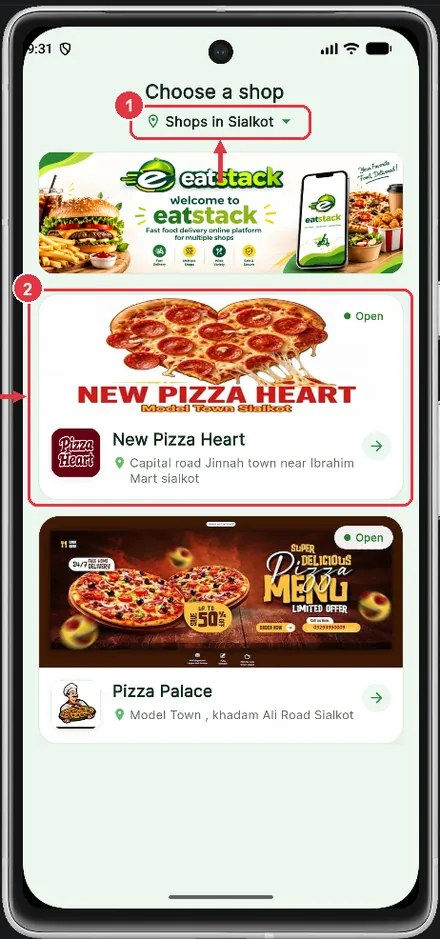 | 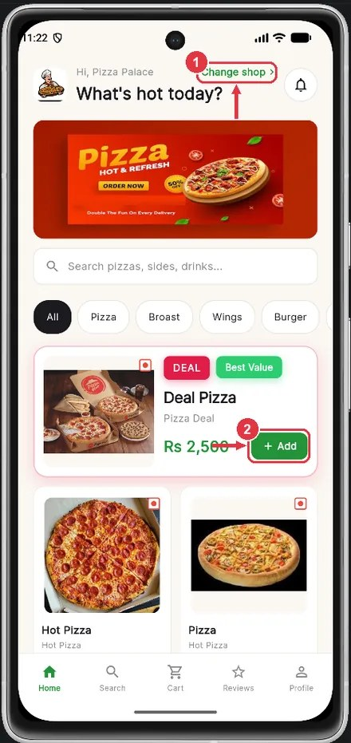 | 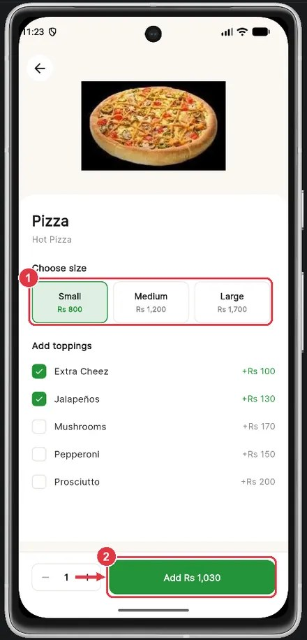 | 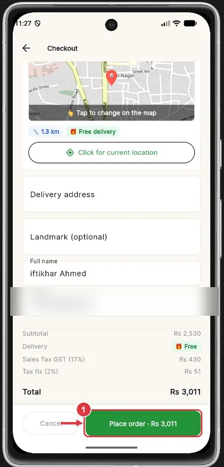 |
| All shops in your city, with an Open badge | Categories, deals, search and the cart | Small, Medium or Large, plus toppings | Delivery on a map, bill with taxes, Place order |

  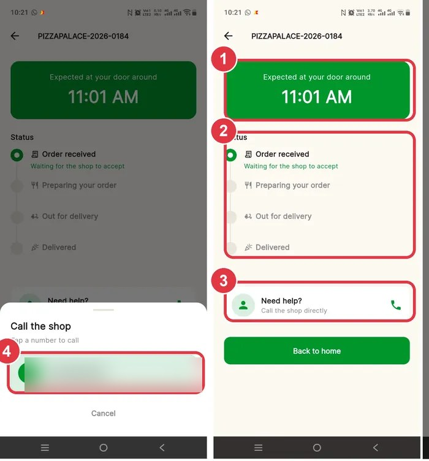 
  <em>Order tracking: expected delivery time, status from Received to Delivered, and "Call the shop".</em>

## For shopkeepers

  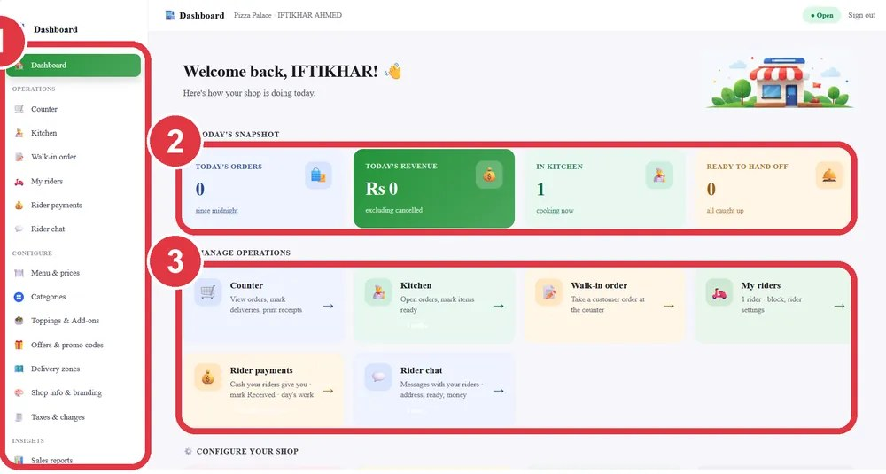 
  <em>Owner Panel dashboard: today's orders and revenue, and quick links to Counter, Kitchen, walk-in orders and riders.</em>

  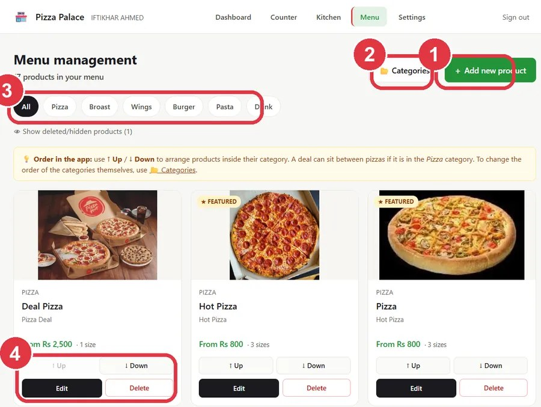 
  <em>Menu management: add products, sizes and prices, arrange categories, mark items as featured.</em>

  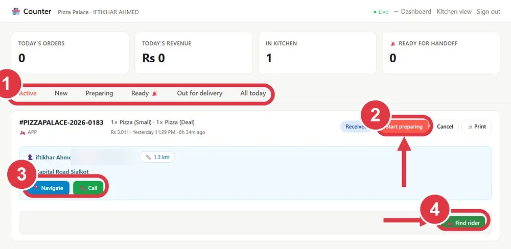 
  <em>Counter screen: every order in one place, from New to Preparing, Ready and Out for delivery, with "Find rider".</em>

  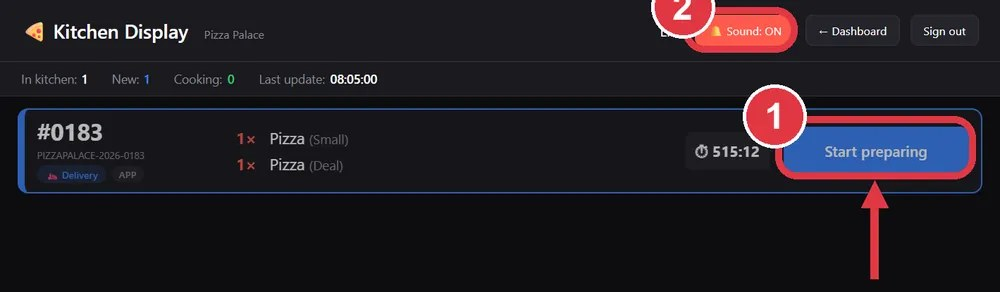 
  <em>Kitchen display: the cook taps "Start preparing", then "Ready".</em>

| Small shop: orders on the owner's phone |
|---|
| 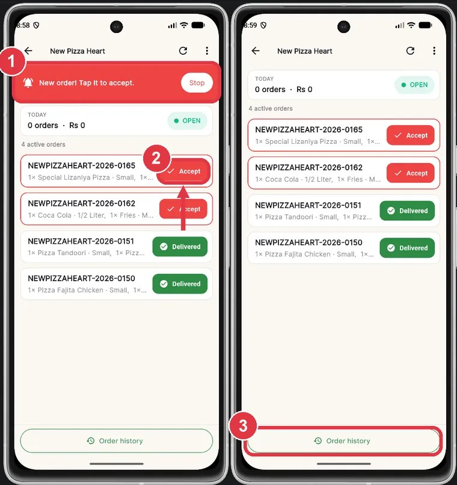 |
| A new order rings on the phone. Tap Accept, then Delivered. Order history is one tap away. |

## For riders

| New order offer | On the way |
|---|---|
| 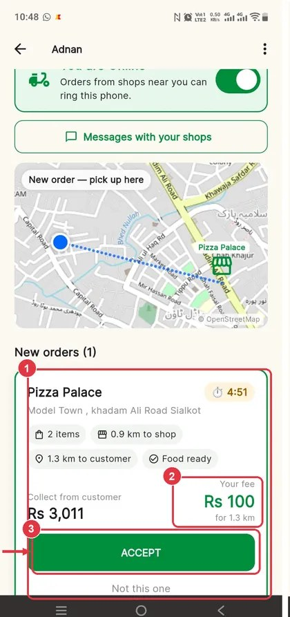 | 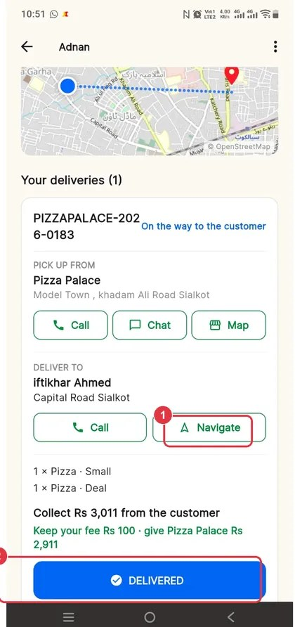 |
| Nearby shops can ring the rider's phone. The rider sees the distance, the cash to collect and the fee, then taps Accept. | Pick-up and delivery details, Navigate, then Delivered: the rider keeps the fee and gives the shop the rest. |

## For the platform owner (Super Admin panel)

  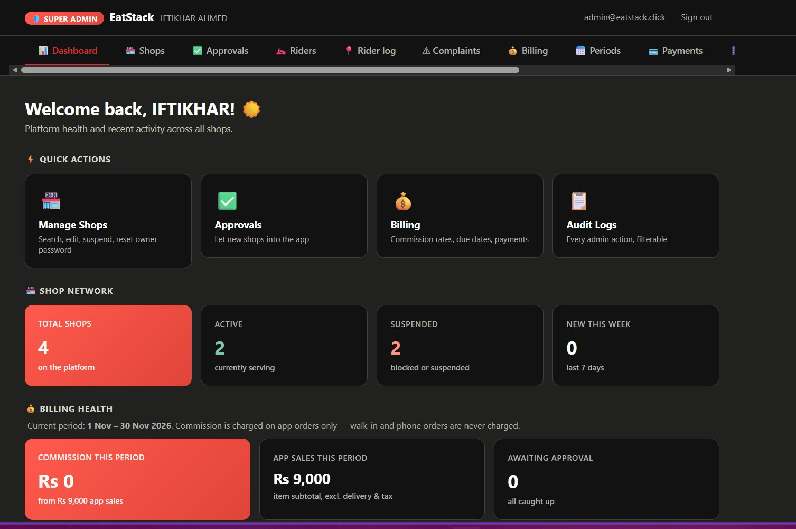 
  <em>Super Admin dashboard: all shops on the platform, active and suspended shops, and this period's commission and app sales.</em>

  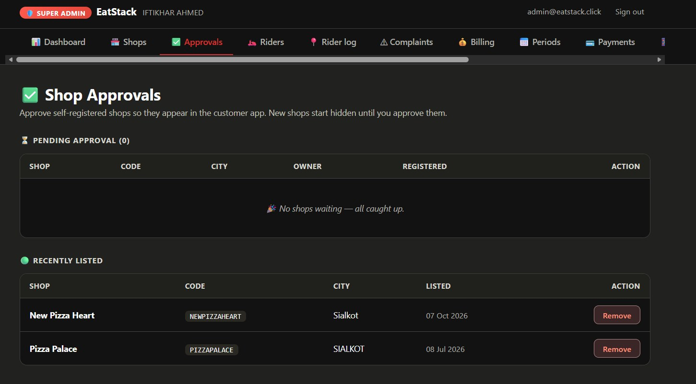 
  <em>Shop approvals: new shops stay hidden from customers until the admin approves them.</em>

  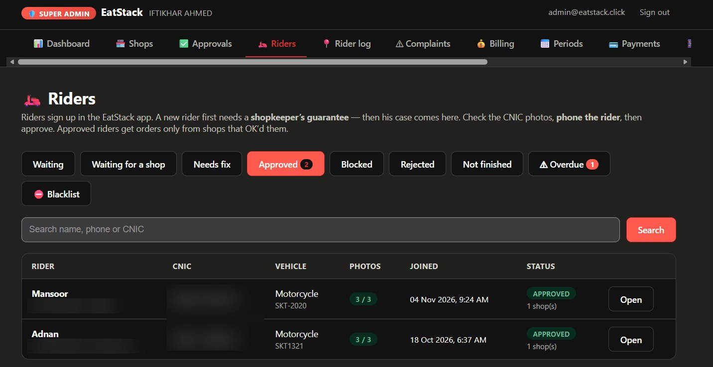 
  <em>Riders: every rider needs a shopkeeper's guarantee and an ID check before approval. Waiting, approved, blocked, overdue and blacklist lists.</em>

  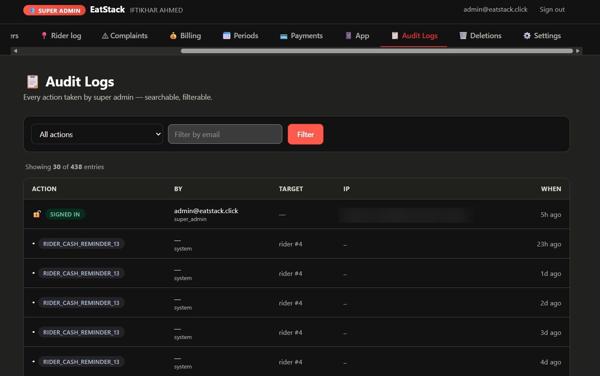 
  <em>Audit logs: every admin and system action is recorded and can be filtered.</em>

  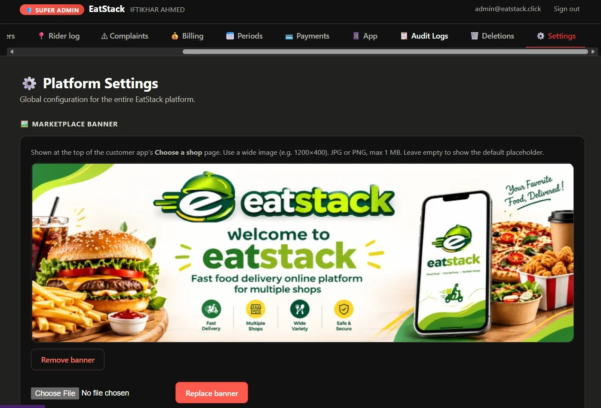 
  <em>Platform settings: for example, the banner shown at the top of the customer app.</em>

---

## What the platform does

| Part | What it does |
|---|---|
| Customer app | Choose a shop, order, pay on delivery or take away, track the order, rate the shop |
| Owner Panel (web) | Menu, prices, toppings, timings, taxes, offers, delivery zones and fees, reports |
| Counter and kitchen screens | Run every order from received to delivered |
| Phone inbox | Small shops handle orders on one phone, without a computer |
| Rider app | Register, go online, accept, deliver, and pay the shop its share |
| Billing | Billing statements and commission for each shop |
| Super Admin panel | Approve shops and riders, billing periods, complaints, payments, audit logs, platform settings |
| Many shops | Each shop's data is kept fully separate |

## In numbers

| What | Size |
|---|---|
| Lines of program | About 26,000 |
| Database tables | 37 |
| Web panels | Owner, Counter, Kitchen, Pickup display |
| User types | Customer, Shopkeeper, Rider, Platform admin |

## Built with

Claude Code · PHP · MariaDB · Flutter (Android) · REST API · OpenStreetMap maps · Easypaisa payments

---

Screens are taken from the EatStack help guide. Phone numbers are hidden.

**Contact:** iftikhar.ahmed.job1@gmail.com · [GitHub profile](https://github.com/iftikhar-ahmed-ai)

© 2026 Iftikhar Ahmed. All rights reserved.
